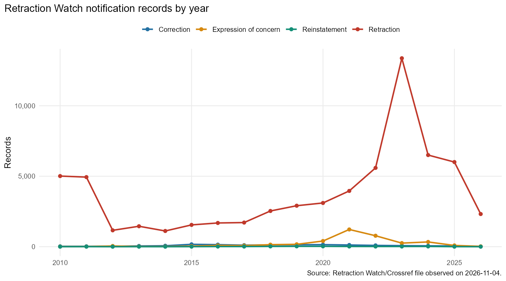

# 基线数据探索

> 状态：已完成  
> 范围：Retraction Watch 基线、OpenAlex 覆盖与对照匹配审计，不含网络模型结果

## 数据范围

- 原始数据：`data/raw/retractions.csv`
- 观察日期：2026-11-04
- 通知记录：73,597
- Retraction：68,155
- 核心窗口：2012–2025 年
- 核心撤稿记录：52,638
- 唯一原因标签：112

## 年度与 DOI 覆盖

2010–2011 年存在明显批量事件，2023 年出现新的高峰。两者都不能直接当作自然增长率。

核心窗口总体有效 DOI 占 93.95%，但 2019 年约 60.54%。DOI 缺失不是随机分布，正式匹配必须按年份、出版社、原因族和文献类型分层报告。

## 原因标签与原因族

高频标签同时包含调查主体、结果不可靠、数据问题和出版流程问题。原因标签不是互斥分类。

复核后的 v2 映射下，核心窗口各分析族覆盖为：

| 分析族 | 核心记录 | 覆盖率 |
|---|---:|---:|
| 出版与同行评审 | 20,915 | 39.7% |
| 图像完整性 | 6,475 | 12.3% |
| 剽窃/署名复合族 | 10,895 | 20.7% |
| 数据与结果完整性 | 2,662 | 5.1% |
| 研究伦理与合规 | 4,427 | 8.4% |
| 材料与方法完整性 | 1,540 | 2.9% |
| 严格错误参照 | 11,667 | 22.2% |
| 未进入分析族或参照 | 3,304 | 6.3% |

原因族允许重叠，不能相加得到总记录数。主族使用实质发现标签；疑虑和错误标签只进入
宽定义敏感性分析。

## 中国大陆候选

| 指标 | 结果 |
|---|---:|
| `China` 标签核心记录 | 26,763 |
| 中国大陆候选唯一 DOI | 26,526 |
| 出版与同行评审唯一 DOI | 15,537 |
| 图像完整性唯一 DOI | 3,438 |
| 剽窃/署名复合族唯一 DOI | 3,183 |
| 数据与结果完整性唯一 DOI | 992 |
| 研究伦理与合规唯一 DOI | 2,557 |
| 材料与方法完整性唯一 DOI | 658 |
| 严格错误/信息不足参照唯一 DOI | 4,728 |

数据与结果完整性为 992 个 DOI，材料与方法完整性为 658 个 DOI，均低于 1,000，
只作探索性分析。文本复用和作者身份拆分结果写入基线表，供次级分析使用。

### 论文级计数

P0 折叠后，49,453 条核心有效 DOI 记录对应 49,444 篇描述性论文；
排除 3 个歧义 DOI 后，主链接面板为 49,291 篇。
中国大陆候选仍为 26,526 个唯一 DOI。

| 指标 | 中国大陆候选论文 |
|---|---:|
| 出版与同行评审 | 15,537 |
| 图像完整性 | 3,438 |
| 剽窃/署名复合族 | 3,183 |
| 数据与结果完整性 | 992 |
| 研究伦理与合规 | 2,557 |
| 材料与方法完整性 | 658 |
| 严格错误参照 | 4,727 |
| 未进入分析族 | 1,066 |
| 含港澳台共标签 | 172 |

论文级数据与结果完整性仍为 992，低于 1,000 主推断门槛。
候选论文中 Hindawi 为 9,943 篇，占 37.5%；该集中度需在 2023 事件专项中
按唯一 DOI、通知记录和发表年份分别拆解。

DOI 冲突与港澳台共标签规则见
[ADR 0004](../decisions/0004-doi-identity-and-hmt-co-labels.md)。

## 作者规模

原始姓名字段中位作者数为 4，95% 分位为 10，最大 88。该分布只用于描述，正式网络必须使用 OpenAlex 作者 ID。

## 2023 年事件构成

| 指标 | 结果 |
|---|---:|
| 中国大陆 2023 撤稿记录 | 10,697 |
| Hindawi | 8,626 |
| Hindawi 占比 | 80.6% |
| 原论文发表于 2022 | 6,988 |
| 原论文发表于 2021 | 2,241 |
| Research Article | 9,629 |

高频标签包括出版社调查、第三方调查、结果不可靠、数据问题、同行评审问题、Paper Mill 和计算机生成内容。

当前解释：2023 峰值主要是出版社集中调查和批量撤稿，不是通知数量直接代表的国家不端率变化。

## 已得到的结论

1. 数据足以支持中国大陆撤稿原因与资源结构的探索。
2. 原因族不能作为互斥分类。
3. 2023 峰值必须独立拆解。
4. 财务资助字段覆盖不足，只能进入第二阶段。
5. 作者网络尚未全量构建，当前没有可报告的网络结论。

## OpenAlex 全量样本

266 个请求批次全部返回 HTTP 200，无 JSON 失败。26,526 个候选 DOI 中：

| 指标 | 结果 |
|---|---:|
| 单一精确匹配 | 26,497 |
| 同 DOI 多作品 | 4 |
| 未找到 | 25 |
| OpenAlex 确认大陆 | 24,978 |
| HMT-only 排除 | 94 |
| 标题严重冲突排除 | 4 |
| 大陆主分析可用 | 24,974 |
| 大陆且机构完整 | 21,842 |
| 大陆且网络完整 | 14,827 |

大陆确认后，机构完整率为 87.45%，通过 70% 门槛。
作者 ID 与机构同时完整的网络样本仅占 59.36%，
网络结论必须明确使用缩小样本。

7 个 OpenAlex 返回作品 DOI 与原候选 DOI 近似但不完全一致，只保留在审计中，
不自动视为匹配。规则见
[ADR 0005](../decisions/0005-openalex-match-and-analysis-subsets.md)。

## 本阶段之后的进展

- 非撤稿对照匹配和已选对照解析已完成。
- 机构层级、行政区和主样本地理映射已完成。
- 对照片本机构地理富化仍受接口限流阻塞。
- 论文层模型。
- 网络、零模型和社群筛选。
- 2023 年 Crossref 分母。
- 资助专项审计。
