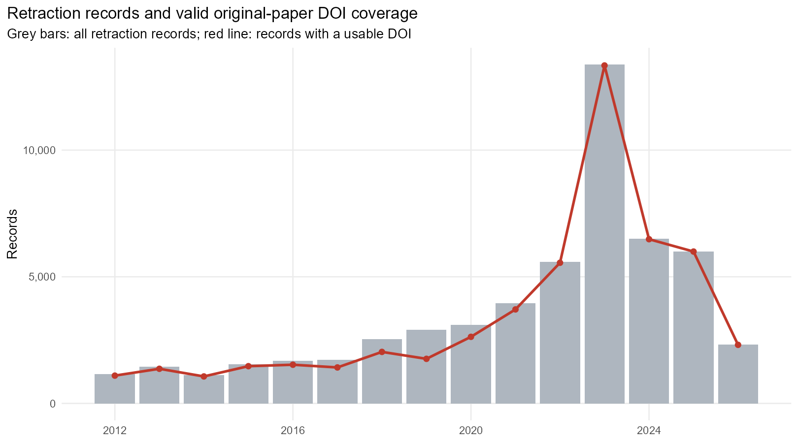
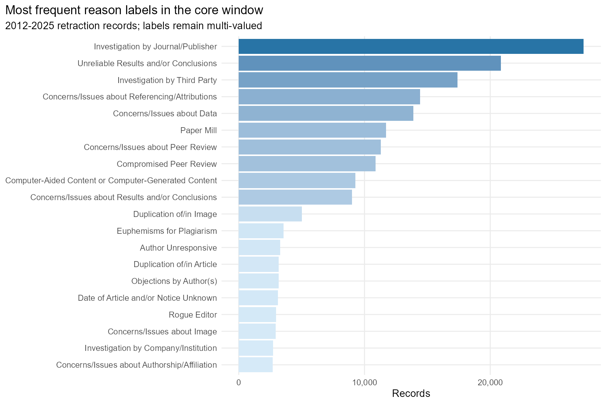
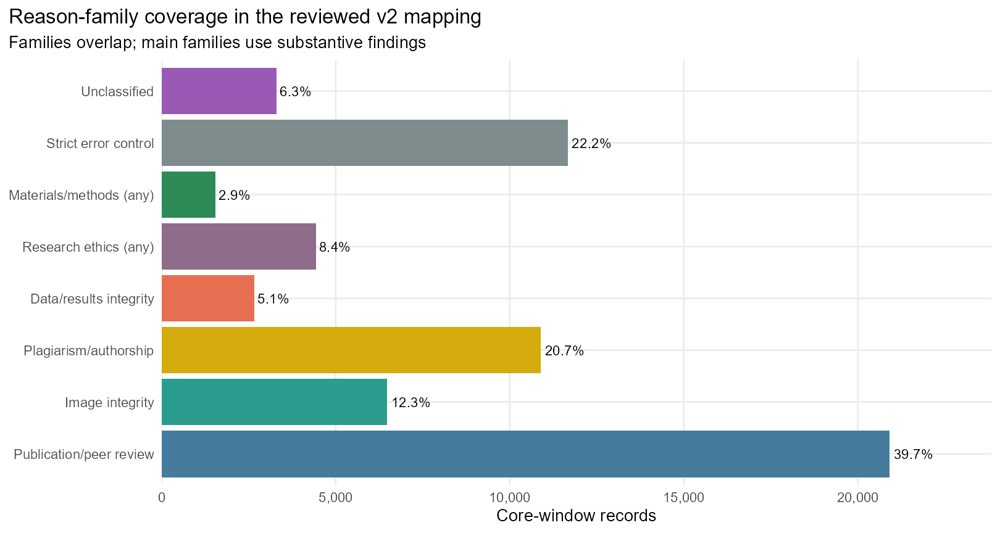
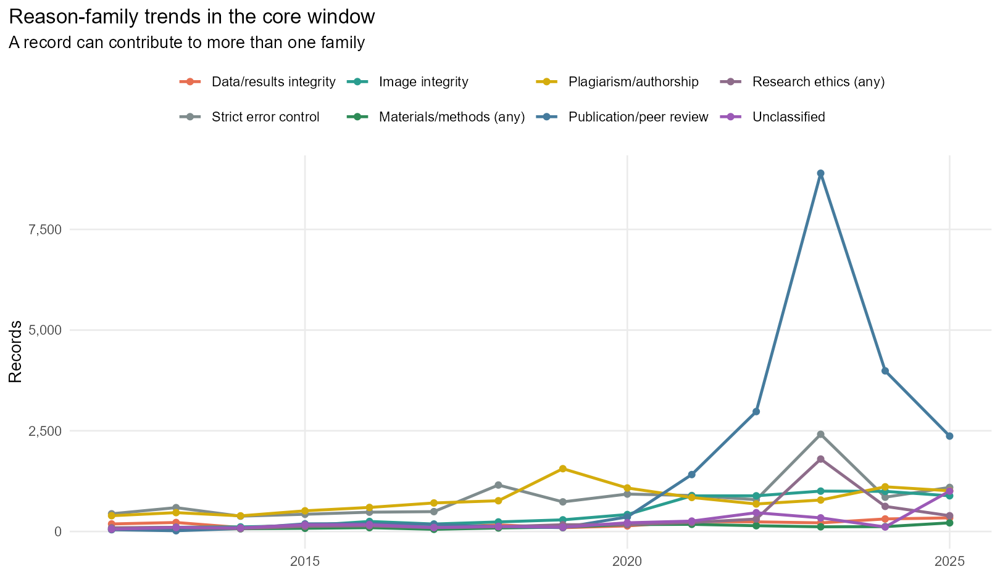
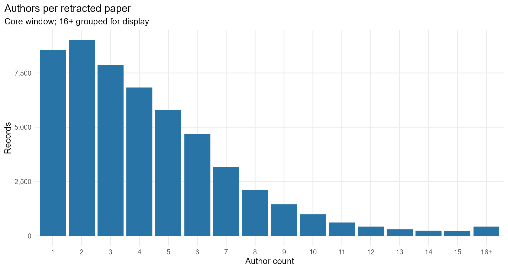

# 基线数据探索

> 状态：已完成  
> 范围：Retraction Watch 单表与接口压测，不含全量作者网络结果

## 数据范围

- 原始数据：`data/raw/retractions.csv`
- 观察日期：2026-11-04
- 通知记录：73,597
- Retraction：68,155
- 核心窗口：2012–2025 年
- 核心撤稿记录：52,638
- 唯一原因标签：112

## 年度与 DOI 覆盖

2010–2011 年存在明显批量事件，2023 年出现新的高峰。两者都不能直接当作自然增长率。

核心窗口总体有效 DOI 占 93.95%，但 2019 年约 60.54%。DOI 缺失不是随机分布，正式匹配必须按年份、出版社、原因族和文献类型分层报告。

## 原因标签与原因族

高频标签同时包含调查主体、结果不可靠、数据问题和出版流程问题。原因标签不是互斥分类。

复核后的 v2 映射下，核心窗口各分析族覆盖为：

| 分析族 | 核心记录 | 覆盖率 |
|---|---:|---:|
| 出版与同行评审 | 20,915 | 39.7% |
| 图像完整性 | 6,475 | 12.3% |
| 剽窃/署名复合族 | 10,895 | 20.7% |
| 数据与结果完整性 | 2,662 | 5.1% |
| 研究伦理与合规 | 4,427 | 8.4% |
| 材料与方法完整性 | 1,540 | 2.9% |
| 严格错误参照 | 11,667 | 22.2% |
| 未进入分析族或参照 | 3,304 | 6.3% |

原因族允许重叠，不能相加得到总记录数。主族使用实质发现标签；疑虑和错误标签只进入
宽定义敏感性分析。

## 中国大陆候选

| 指标 | 结果 |
|---|---:|
| `China` 标签核心记录 | 26,763 |
| 中国大陆候选唯一 DOI | 26,526 |
| 出版与同行评审唯一 DOI | 15,537 |
| 图像完整性唯一 DOI | 3,438 |
| 剽窃/署名复合族唯一 DOI | 3,183 |
| 数据与结果完整性唯一 DOI | 992 |
| 研究伦理与合规唯一 DOI | 2,557 |
| 材料与方法完整性唯一 DOI | 658 |
| 严格错误/信息不足参照唯一 DOI | 4,728 |

数据与结果完整性为 992 个 DOI，材料与方法完整性为 658 个 DOI，均低于 1,000，
只作探索性分析。文本复用和作者身份拆分结果写入基线表，供次级分析使用。

## 作者规模

原始姓名字段中位作者数为 4，95% 分位为 10，最大 88。该分布只用于描述，正式网络必须使用 OpenAlex 作者 ID。

## 2023 年事件构成

| 指标 | 结果 |
|---|---:|
| 中国大陆 2023 撤稿记录 | 10,697 |
| Hindawi | 8,626 |
| Hindawi 占比 | 80.6% |
| 原论文发表于 2022 | 6,988 |
| 原论文发表于 2021 | 2,241 |
| Research Article | 9,629 |

高频标签包括出版社调查、第三方调查、结果不可靠、数据问题、同行评审问题、Paper Mill 和计算机生成内容。

当前解释：2023 峰值主要是出版社集中调查和批量撤稿，不是通知数量直接代表的国家不端率变化。

## 已得到的结论

1. 数据足以支持中国大陆撤稿原因与资源结构的探索。
2. 原因族不能作为互斥分类。
3. 2023 峰值必须独立拆解。
4. 财务资助字段覆盖不足，只能进入第二阶段。
5. 作者网络尚未全量构建，当前没有可报告的网络结论。

## 尚未完成

- 全量 OpenAlex DOI 匹配。
- 中国大陆确认和机构完整子集。
- 非撤稿对照匹配。
- 机构层级与省市映射。
- 论文层模型。
- 网络、零模型和社群筛选。
- 2023 年 Crossref 分母。
- 资助专项审计。
